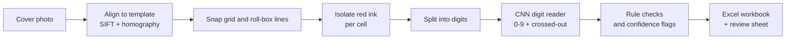

# KUET SmartMark

**Read handwritten marks from exam answer-script covers and fill the marks spreadsheet automatically.**

SmartMark takes a photo of a KUET answer-script cover, finds the 7-digit roll number and the red-pen marks
in the 8 × 4 marks table, and writes them into an Excel workbook. Anything it is not sure about is flagged for
the teacher to confirm instead of being guessed. It runs fully offline on an ordinary Windows laptop.

---

## Features

- **Photo to Excel in about 1–2 seconds per cover**: section (A/B), roll number and all 32 mark cells.
- **Flags instead of guesses**: low-confidence digits, marks above 35, question totals above 35, writing in
  the wrong section, empty or unclear roll boxes, duplicate covers and dark writing that is not red ink.
- **Crossed-out marks are read as empty**, and a clean correction written beside them is kept.
- **Teacher app** with a review screen: the photo of each doubtful value, what was read, how sure, and why.
  Keep, Blank or type the right value; progress is saved as you go.
- **Live capture**: take photos with a phone through its browser (no app needed), watch a synced photo
  folder, or use a webcam. The live workbook updates after every cover.
- **Excel output with live formulas**: one row per student (Section A and B covers joined by roll number),
  question totals, best 3 of 4 questions per section, final total, yellow cells and comments for anything
  still to check, plus a review sheet with the cropped photos.
- **Private by design**: no internet connection, no cloud service; photos and marks stay on the laptop.
- **Standalone `SmartMark.exe`** for teachers; no Python installation needed.

## How it works



1. **Alignment**: SIFT features of the photo are matched to a template of the printed cover and a homography
   flattens the page onto a 300-dpi canvas. Printed lines are then located precisely, so every cell crop
   follows the real grid even on curved or tilted photos.
2. **Red-ink detection**: ink is separated from print by being darker *and* redder than the surrounding paper.
   Small photos (e.g. 1080p) use a variant that takes darkness from the sharp brightness channel and colour from
   a smoothed redness ratio, because JPEG stores colour at half resolution.
3. **Digit reading**: a small convolutional network (pre-trained on 280,000 EMNIST digits plus synthetic
   scribbles, fine-tuned on real cover digits) reads each digit or marks it as crossed out. It runs through
   OpenCV's DNN module from an ONNX file, so the app does not need PyTorch.
4. **Safety checks**: confidence threshold (0.85 by default, 0.95 for small photos), mark-range and section
   rules, and a check that no cell holding dark writing is ever reported as blank.

## Results

Measured on the 48 demo covers in this repository. The held-out test set is 6 students (12 covers) never
used for training.

| Measure | Result |
|---|---|
| Digit accuracy, held-out students | 98.2 % (270 digits) |
| Mark-cell accuracy, held-out students | 96.5 % (144 cells) |
| Roll-number accuracy, held-out students | 100 % (12 covers) |
| Wrong values that were **not** flagged, all 48 covers, full-resolution photos | **0** of 541 (5 wrong, all flagged) |
| Values flagged for checking, full-resolution photos | about 1 in 30 |
| Wrong values not flagged, covers shrunk to 1080p size (also dull, blurred and heavily compressed copies) | **0** |
| Values flagged for checking at 1080p size | about 1 in 3 |

Flag rates were measured at the earlier 0.80 threshold; 0.85 flags slightly more. The demo covers come from a
small number of writers, so accuracy on new handwriting is still to be confirmed (milestone M8).

## Getting started

### For teachers

1. Get the `SmartMark` folder (built with `build_exe.bat`, see below) and double-click `SmartMark.exe`.
2. Follow `How to use SmartMark.txt` inside the folder (the same text as [docs/TEACHER_GUIDE.md](docs/TEACHER_GUIDE.md)).

### For developers

Requirements: Windows 10/11, a standard Python 3.10–3.14 (not the free-threaded build) with Tkinter (python.org installer, "tcl/tk" option).

```bat
cd /d E:\path\to\KUET-SmartMark
py -3 -m venv .venv
.venv\Scripts\python.exe -m pip install --only-binary=:all: -r requirements.txt
.venv\Scripts\python.exe scripts\smartmark_app.py
```

Build the teacher package (output: `dist\SmartMark\`, about 250 MB; zip the folder to share it):

```bat
build_exe.bat
```

## Using the app

| Step | What it does |
|---|---|
| **1 Scan a folder** | Reads every photo in a folder, with live progress and counts (read cleanly, to check, to retake). |
| **2 Live camera** | Capture covers one by one; each is read at once and added to the live workbook. |
| **3 Check flagged** | One doubtful value at a time: photo, reading, confidence and reason. Keep, Blank or type + Enter. |
| **4 All covers** | Every cover with an OK / CHECK / RETAKE status and a full-page view of what was read. |
| **5 Export Excel** | Applies your answers and writes a new workbook in `output\`. Earlier workbooks are never overwritten. |

Live camera sources:

| Source | Notes |
|---|---|
| **Phone browser** (recommended) | SmartMark shows an address; open it in the phone's browser and tap *Take photo*. Full-resolution photos, result shown on the phone. Phone and laptop on the same Wi-Fi (or the laptop on the phone's hotspot). |
| **Watch a folder** | Reads each new photo that appears in a folder, e.g. one synced from the phone by OneDrive or Syncthing. |
| **IP Webcam / webcam** | Live preview with automatic capture when the cover is held still. Lower resolution, so more values are flagged. |

Photo tips: lay the cover flat, photograph from straight above, fill most of the picture with the page, and
use good light. Marks must be written in red pen.

## Project structure

```
KUET-SmartMark/
├── scripts/
│   ├── smartmark_app.py       teacher app (CustomTkinter)
│   ├── sm_align.py            alignment, cell geometry, red-ink detection, digit segmentation
│   ├── sm_camera.py           webcam / phone page / folder-watch capture
│   ├── 01-03_*.py             dataset inventory, label import and validation
│   ├── 04-05_*.py             alignment and cropping + evaluation
│   ├── 06-08_*.py             digit dataset, public digits, model training
│   ├── 09_read_sheets.py      end-to-end reader (confidence threshold: CONF_THRESHOLD)
│   └── 10_fill_excel.py       marks workbook
├── templates/kuet_cover_v1/   cover template and region map
├── models/                    digit reader (ONNX + PyTorch weights)
├── annotations/               labels for the demo covers (Excel is the source of truth)
├── data/raw/                  48 demo cover photos
├── docs/                      teacher guide, development guide, photo issues
├── reports/                   evaluation reports
└── build_exe.bat              builds SmartMark.exe
```

The full pipeline (labelling, training, evaluation, every script and its outputs) is documented in
[docs/DEVELOPMENT.md](docs/DEVELOPMENT.md). Common photo problems are listed in
[docs/IMAGE_ISSUES.md](docs/IMAGE_ISSUES.md).

## Roadmap

- [x] M1 Dataset inspection, labelling workflow and cover template
- [x] M2 Alignment and cell cropping
- [x] M3 Digit dataset from real covers + public EMNIST digits
- [x] M4 Digit reader (CNN, ONNX)
- [x] M5 End-to-end reading with safety flags
- [x] M6 Excel marks workbook
- [x] M7 Teacher app, live capture and `SmartMark.exe`
- [ ] M8 Pilot with teachers on new scripts; retrain with covers from 10–20 new writers

## Limitations

- Built for one cover design (KUET answer script). A new design needs a new template (`scripts/build_template.py`).
- Marks must be in red pen; other colours are flagged rather than read.
- The digit reader has so far been trained and tested on a small number of writers.
- Low-resolution photos (below about 1,475 px page height) are refused and must be retaken.

## Author

**Indrajit** ([@Indrajit147](https://github.com/Indrajit147)), Department of Electrical and Computer Engineering,
Khulna University of Engineering & Technology (KUET).

This repository does not include a license yet.
